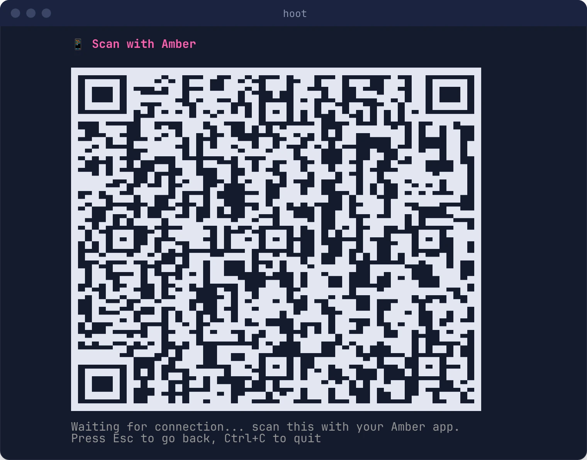

# Sign In with Amber (NIP-46)

[Amber](https://github.com/greenart7c3/Amber) is an Android signer app. With it, your private key stays on your phone: Hoot shows a QR code, you scan it with Amber, and every time Hoot needs a signature it asks Amber over Nostr relays ("remote signing", [NIP-46](https://github.com/nostr-protocol/nips/blob/master/46.md)).

## Sign In

1. In Amber, make sure you have an account set up.
2. Run `hoot` and choose **Scan QR with Amber** (📱).
3. Hoot connects to its relays first, then shows a QR code. If the QR is cut off, make the terminal window bigger; it redraws as you resize.

   

   *Example only: scan the QR code in your own terminal, not this one.*
4. In Amber, scan the QR code and approve the connection.
5. Hoot shows **Logged in as** followed by your name. The home screen shows your name, your NIP-05 address (with ✓) and your bio, taken from your Nostr profile. If you have no profile yet, it shows your shortened npub instead.

Press **Esc** on the QR screen to cancel. This closes the pairing session.

## What Works with Amber

| Feature | With Amber |
|---|---|
| Posting, replies, likes | ✅ Amber signs each one. Approve it on your phone if Amber asks. |
| Feed, threads | ✅ |
| DMs (read and send) | ✅ Amber encrypts and decrypts on your phone. Hoot only decrypts the newest messages, since each one is a round trip to the phone. |
| Zaps | ✅ Amber signs the zap request; your wallet connection pays |
| Tipping | ✅ Uses your wallet connection, not your Nostr key |
| CLI commands (`hoot -m …`) | ❌ The CLI only uses keys stored on this computer |

## Continue Without Scanning Next Time

After you pair once, the login screen offers **📱 Continue as NAME (Amber)**. Choosing it reconnects to Amber without a QR code: Hoot checks that Amber still answers for the same account, and Amber may ask you to approve on your phone.

The pairing is saved in `amber_session.json` in your [config directory](first-profile.md#where-hoot-stores-things). It lets this computer *ask* Amber to sign, and Amber's own approval settings still apply. To remove it, highlight **Continue as…** and press **`x`**, then **`y`**. To fully revoke access, also remove Hoot from the connected apps in Amber.

## Which Relays Are Used for Pairing

The QR code lists your relays plus `wss://relay.damus.io` and `wss://nostr.wine`, so Amber can always reach Hoot even if your own relays are unusual. You can review your relays first with **🔗 Configure relays** on the login screen.

## Troubleshooting

### "refusing to dial relays through HTTPS_PROXY=…"

A proxy variable (`HTTPS_PROXY`, `HTTP_PROXY`, `ALL_PROXY` or `SOCKS_PROXY`) is set in the shell that launched Hoot, often inherited from Tor or a VPN tool. Sign-in needs a direct connection. Unset the variable for Hoot:

```bash
env -u HTTPS_PROXY -u HTTP_PROXY -u ALL_PROXY hoot
```

### Stuck on "Waiting for connection..."

- Check that Amber shows the connection as approved.
- Make sure your phone has internet access.
- Press **Esc** and try again; each attempt uses a fresh session.

### "Couldn't reconnect: Amber didn't answer"

Open Amber on your phone (it may be asleep or offline) and try **Continue as…** again. If it still fails, press `x` to forget the saved session and scan a new QR code.

### "Sign-in failed: …"

The message explains what went wrong (for example, no relay could be reached). Check your network, review your relays with **🔗 Configure relays**, and try again.
