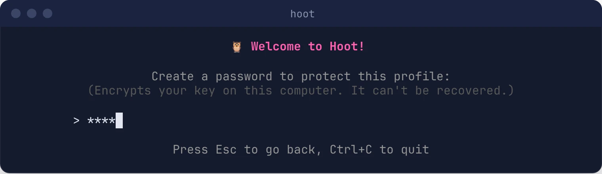
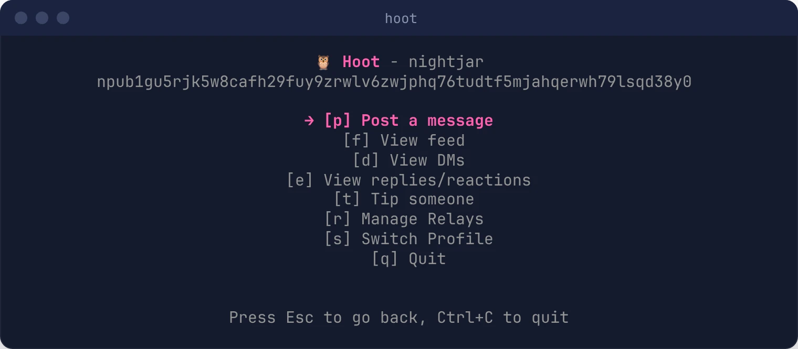
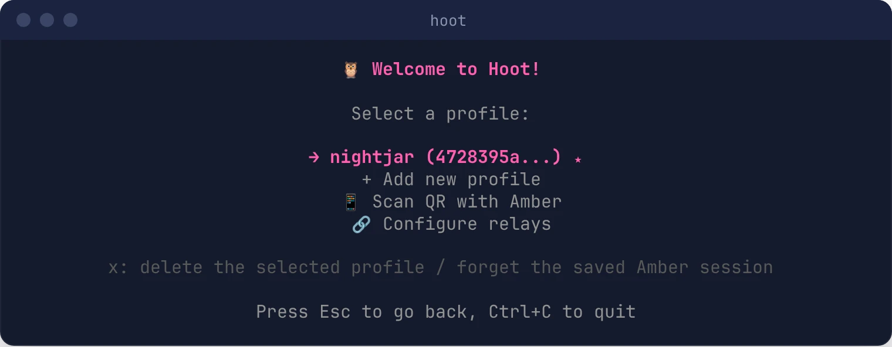

# Your First Profile

A Hoot profile is a Nostr private key (`nsec`) that Hoot stores on your computer, encrypted with a password you choose.

Don't want your key on this computer at all? [Sign in with Amber](amber-login.md) instead.

## You Need an nsec

Hoot imports existing keys; it doesn't generate new ones. If you don't have a Nostr account yet, create one in any Nostr app (for example Amber, Primal or Damus) and export the `nsec1…` private key from its settings.

> **Keep your nsec secret.** Anyone who has it controls your account, and it can't be changed or revoked.

## Add a Profile in the TUI

1. Run `hoot`.
2. Choose **Create new profile**. If you already have profiles, choose **+ Add new profile**.
3. Enter a name for the profile (e.g. `main`). This is only a local label.
4. Paste your `nsec1…` key.
5. Choose a password. It encrypts the key on disk, and you'll type it each time you unlock this profile.

   

6. You're signed in and on the home screen, which shows your full npub so you can copy and share it.

   

> **There is no password recovery.** If you forget the password, delete the profile and add it again with your nsec.

Press **Esc** at any step to go back to the menu without saving.

## Signing In Later

Run `hoot`, pick your profile from the list (the last one you used is marked ★), and enter its password.



## Multiple Profiles

- Add more accounts with **+ Add new profile**.
- Switch accounts from the home screen with **[s] Switch Profile**. This fully signs out the current account, including any Amber session, before you pick another.
- Delete a profile: on the login screen, highlight it and press **`x`**, then **`y`** to confirm. Its encrypted key is removed from this computer; you'll need the nsec to add it again.

## Your npub

Your public key is shown on the home screen. From the command line:

```bash
hoot -npub
```

## Using Your Profile from the CLI

CLI commands such as `hoot -m "gm"` use the profile you last signed in to in the TUI (or your only profile). If you also have a key stored with `hoot -s` (see below), the CLI uses that one instead. Your password is read from `HOOT_PASSWORD` if set, or prompted for. See the [CLI Reference](../cli-reference.md).

## Where Hoot Stores Things

| OS | Config directory |
|---|---|
| Linux | `$XDG_CONFIG_HOME/hoot/`, usually `~/.config/hoot/` |
| macOS | `~/Library/Application Support/hoot/` |
| Windows | `%APPDATA%\hoot\` |

| File | Contents |
|---|---|
| `profiles.json` | Your profiles. Private keys are encrypted (scrypt + NaCl secretbox); public keys and names are not. |
| `nostr_key.enc` | Key stored by `hoot -s` (older CLI-only setup, see below) |
| `relays.txt` | Your relay list, if you've customised it |
| `nwc.txt` | Your wallet connection, if you've set one up. It contains a secret that can spend from that connection, so keep it private. |
| `amber_session.json` | Your saved Amber pairing, if any (see [Sign In with Amber](amber-login.md#continue-without-scanning-next-time)). Keep it private. |
| `hoot_cache.db` | Local cache of recent posts and profiles (safe to delete) |

### Keys Stored with `hoot -s`

Older setups stored a single key with `hoot -s -k <nsec>`. The first time you open the TUI with no profiles, that key is imported as a profile named **Default**, using the same password.

## Next Steps

- [Post your first note](../posting-notes.md)
- [Set up tipping](../wallet-connect.md)
