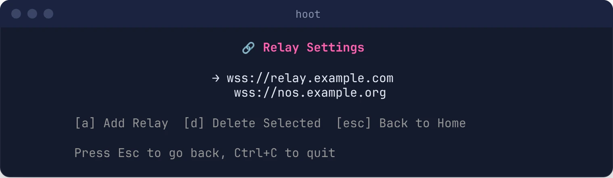

# Posting Notes

Hoot publishes your note to every relay in your list. The post succeeds if at least one relay accepts it.

## From the TUI

1. Run `hoot` and sign in.
2. Choose **[p] Post a message** (or press `p`).
3. Type your note and press **Enter**.
4. You'll see **Posted successfully!** once a relay accepts it.


## From the CLI

```bash
hoot -m "Hello Nostr! #introduction"
```

Hoot prints which relays accepted the note, then exits. `#hashtags` are added as `t` tags so they show up in hashtag searches; this works from the TUI too.

Send a note to specific relays only (instead of your saved list):

```bash
hoot -r "wss://relay1.example.com,wss://relay2.example.com" -m "Just these relays"
```

## Relays

If you haven't set up your own list, Hoot uses three free, general-purpose relays that accept posts from anyone:

```
wss://relay.damus.io
wss://nos.lol
wss://relay.primal.net
```

When you add your own, prefer free relays unless you've paid for one. **Paid relays** let anyone read but reject posts, replies, likes and DMs from people who aren't members, so a paid relay you haven't joined just shows up as a failure each time you post.

### Manage Relays in the TUI

Open **[r] Manage Relays** from the home screen, or **🔗 Configure relays** from the login screen before you sign in.

- **a**: add a relay (must start with `wss://` or `ws://`)
- **d**: delete the selected relay
- **↑/↓**: move between relays
- **Esc**: go back

Changes are saved immediately.



### The relays.txt File

The list is stored in `relays.txt` in your [config directory](getting-started/first-profile.md#where-hoot-stores-things), one URL per line. Lines starting with `//` are ignored:

```
wss://relay.damus.io
wss://nos.lol
// wss://relay.i-dont-use-anymore.com
```

> If there's a `relays.txt` in the **current directory** when you run Hoot, that file is used instead of the one in your config directory.

## If Posting Fails

**"failed to publish to any relay"** means no relay accepted the note:

- Check your internet connection.
- Some relays rate-limit or require payment; add a couple of free public relays such as `wss://nos.lol`.
- If you signed in with Amber, check whether Amber is waiting for you to approve the signature.

## See Your Posts

```bash
hoot -l    # your last 4 notes
```

In the TUI, **[f] View feed** shows the newest notes from everyone on your relays. See [Feed, DMs and Replies](reading.md).
