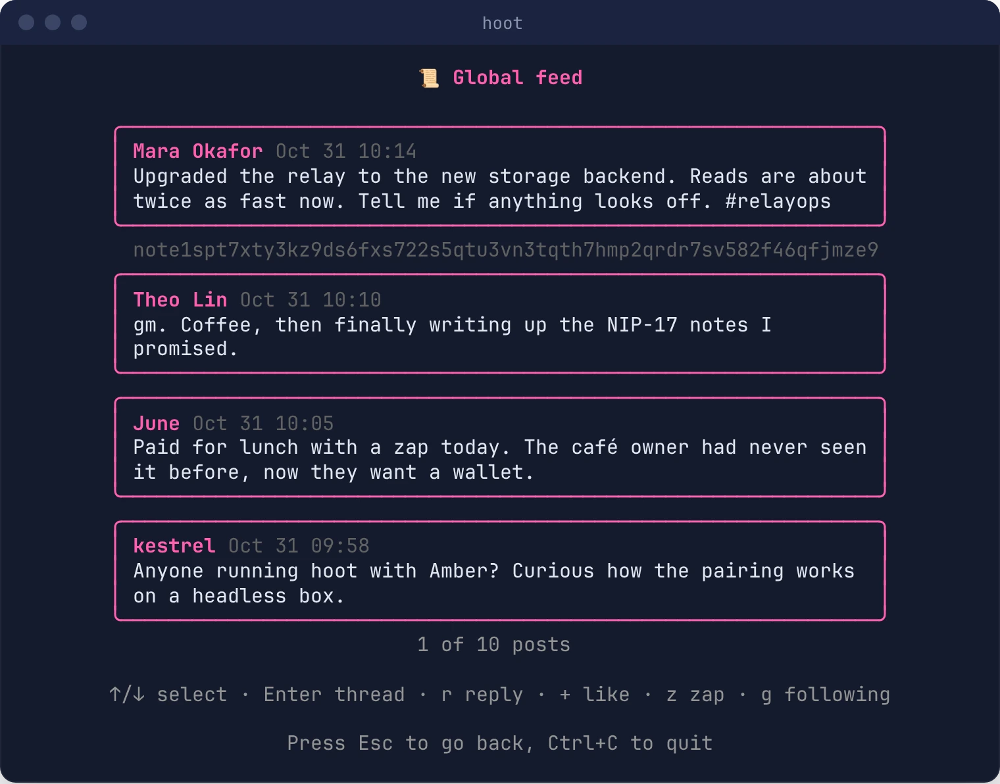
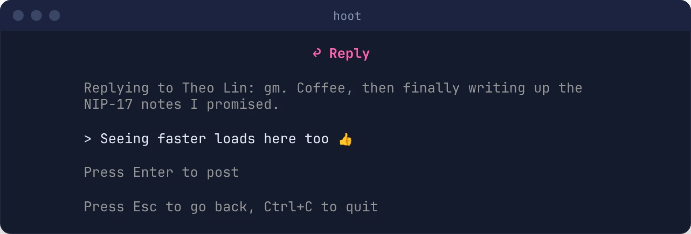
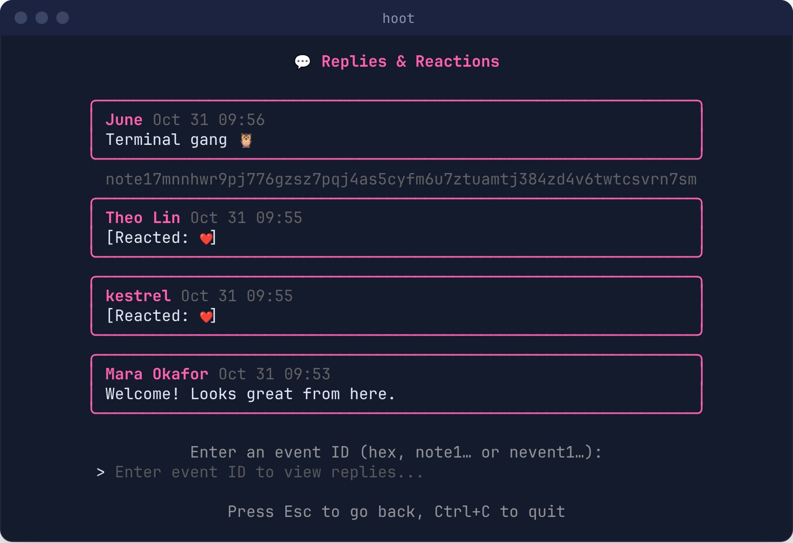

# Feed, DMs and Replies

## Feed

**[f] View feed** (press `f` on the home screen) shows the 20 newest notes, newest first, with each author's **name** from their profile (or a short npub if they haven't set one).

- **`g`** switches between the **Global** feed (everyone on your relays) and **Following** (people in your contact list).
- **↑/↓** (or **j/k**) selects a post. The selected post's `note1…` ID is shown under it, so you can copy it.
- **Enter** opens the post's **thread**: its replies and reactions. Enter on a reply opens *that* thread; **Esc** goes back to the feed.



If none of your relays can be reached, the global feed shows the most recent posts Hoot cached locally.

A thread shows the post at the top and its replies and reactions below:


### Act on a Post

On the selected post (in the feed or a thread):

| Key | Action |
|---|---|
| `r` | **Reply.** Write your reply and press Enter; Esc cancels. Replies are threaded properly (NIP-10), so other apps show them in the right place. |
| `+` or `l` | **Like** (a NIP-25 reaction) |
| `z` | **Zap**: enter an amount in sats. See [Tipping and Zaps](wallet-connect.md). |



To see only your own notes from the CLI:

```bash
hoot -l    # your last 4 notes
```

## Direct Messages

**[d] View DMs** shows your direct messages, sent and received, newest first:

- 🔒 **Private messages (NIP-17).** Gift-wrapped: relays can't see who you're talking to, or when. This is the current Nostr DM standard.
- **Legacy DMs (NIP-04)**, without the 🔒, which many older apps still send. They're encrypted, but relays can see who is messaging whom.

Received messages show as `[DM from]: …`; sent ones as `[DM to NAME]: …`.


**Sending:** on the DMs screen press **`n`** for a new message (enter an `npub1…` or hex public key, then your message), or **`r`** to reply to the selected conversation. Hoot always sends NIP-17 private messages, delivered to the recipient's DM inbox relays if they've published them (kind 10050).

From the CLI:

```bash
hoot -dms                              # read
hoot -dm npub1... -m "hi there"        # send a private message
```

DMs work with both an imported profile and [Amber](getting-started/amber-login.md). With Amber, your phone decrypts each message, so Hoot only decrypts the newest ~20 private and ~30 legacy messages, and Amber may ask you to approve.

## Replies and Reactions by ID

**[e] View replies/reactions** asks for a note's ID and lists its replies and reactions, newest first. You can enter a `note1…`, `nevent1…` (its relay hints are used too), `nostr:` link, or 64-character hex ID.



From the CLI:

```bash
hoot -replies note1...
```

## View Your Profile

```bash
hoot -p    # prints your profile (kind 0) as JSON
```

To change it, use [`-set`](cli-reference.md#update-your-profile).
